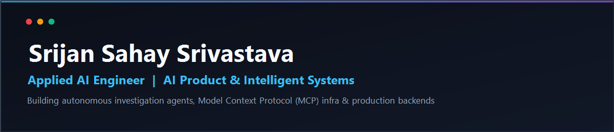

  

  # Srijan Sahay Srivastava
  
  **Applied AI Engineer &bull; AI Product &bull; Forward Deployed Engineering (FDE)**
  
  
  
  
  

---

### ⚡ Quick Overview

- 🔭 **Current Role**: Applied AI Engineer at **[Shipsy](https://shipsy.io)**, building autonomous investigation agents, enterprise MCP infrastructure, and natural-language query systems.
- 🎯 **Target Roles**: Applied AI Engineer, AI Product Engineer, Forward Deployed Engineer (FDE).
- 🏆 **Awards**: **Star Performer** & **"10x with AI"** @ Shipsy &bull; **2nd Runner-Up** @ Hack the Space 2024 & Hackhound 3.0.
- 🌐 **Open Source**: Contributor to the Python Model Context Protocol (MCP) ecosystem.

---

### 🚀 Featured Work & Contributions

| Project / Role | Focus & Impact | Highlights & Stack |
| :--- | :--- | :--- |
| **Enterprise Investigation Agent** *(Shipsy)* | Built an autonomous agent for automated issue diagnosis and root-cause analysis (RCA) across internal logs, codebases, and configs. | `LangGraph` `MCP` `FastAPI` 🏆 *Star Performer & "10x with AI"* |
| **[OpenSearch MCP Server](https://github.com/SrijanSahaySrivastava/opensearch-mcp-server-py)** *(Open Source)* | Implemented fixes for query timeout handling and streaming HTTP endpoints on the OpenSearch Model Context Protocol server. | `Python` `MCP` `OpenSearch` 🛠️ *Open Source Contribution* |
| **[Notify](https://github.com/SrijanSahaySrivastava)** *(Hack the Space 2024)* | AI-powered personal knowledge canvas with dynamic mind maps, flashcard synthesis, and deep semantic RAG querying. | `FastAPI` `RAG` `LLMs` 🥈 *2nd Prize Winner* |
| **[DeZap](https://github.com/SrijanSahaySrivastava)** *(Hackathon Winner)* | Decentralized workflow automation engine executing programmatic triggers and actions across distributed services. | `Node.js` `APIs` `Microservices` 🥇 *Hackathon Winner* |
| **[LawGPT](https://github.com/SrijanSahaySrivastava/LawGPT)** *(Smart India Hackathon)* | Domain-specific legal intelligence assistant retrieving and synthesizing insights from Indian statutes and case precedents. | `Python` `NLP` `RAG` ⚖️ *SIH Project* |

---

### 🧰 Tech Stack

  <strong>AI & Agents:</strong> 
  
  
  
  
  
  

  <strong>Backend, Data & Cloud:</strong> 
  
  
  
  
  
  

---

### 📊 Streak & Activity

  

